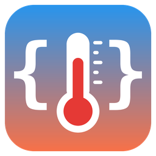

# ❄️ Template Climate UI

[](https://github.com/hacs/integration)
[](LICENSE)
[](https://github.com/dvbit/ha-template-climate-ui/releases)



Create **climate entities from templates and actions, entirely from the UI**.
A fork of [jcwillox/hass-template-climate](https://github.com/jcwillox/hass-template-climate)
with a config flow, an options flow and a live preview — no YAML.

🇮🇹 [Leggi in italiano](README.it.md) · 📐 [Specification](SPEC.md)

## Why

- Combine sensors, switches and scripts into one thermostat card.
- Control "dumb" devices (IR air conditioners, relays) and keep an optimistic state.
- Home Assistant 2026.10 ships a UI template climate in core, but it only covers HVAC mode,
  HVAC action and temperature. This integration also covers **fan, preset, swing, humidity
  and heat/cool ranges**, with the same options as the original YAML integration.

## Installation

1. HACS → ⋮ → *Custom repositories* → `https://github.com/dvbit/ha-template-climate-ui`,
   type **Integration**.
2. Install **Template Climate UI** and restart Home Assistant.
3. *Settings → Devices & services → Add integration → Template Climate UI*.

Requires Home Assistant **2026.9.0** or newer. It can run side by side with the original
`climate_template` YAML integration.

## Configuration

One form, four sections. A preview at the bottom shows the resulting climate while you type.

| Section | Content |
|---|---|
| *(top)* | Name, optional existing device to attach the entity to |
| **State templates** | current/target temperature, high/low, humidity (current, target, min, max), HVAC mode, HVAC action, fan, preset, swing, min/max temperature |
| **Actions** | `set_temperature`, `set_hvac_mode`, `set_fan_mode`, `set_preset_mode`, `set_swing_mode`, `set_humidity` |
| **Modes and limits** | HVAC modes, fan/preset/swing lists (custom values allowed), min/max temperature, step, precision |
| **Advanced** | availability, icon, picture, extra attributes, variables |

Rules (same as the original integration):

- Anything left empty works in **optimistic mode**: the entity remembers what you set.
- A feature (fan, preset, swing, target humidity, target temperature) appears only if
  **its template or its action** is set.
- `unknown`/`unavailable` template results are ignored; invalid values are logged and skipped.
- In `heat_cool` the card shows a low/high range instead of a single target.

Variables available in actions:

| Action | Variables |
|---|---|
| `set_temperature` | `temperature`, `target_temp_high`, `target_temp_low`, `hvac_mode` |
| `set_hvac_mode` | `hvac_mode` |
| `set_fan_mode` | `fan_mode` |
| `set_preset_mode` | `preset_mode` |
| `set_swing_mode` | `swing_mode` |
| `set_humidity` | `humidity` |

`this` (the entity state) and the **Advanced → Variables** are available in every template and action.

Everything can be changed later from **Configure** on the integration entry; the entity reloads.

## Examples

### 1. IR air conditioner (Broadlink) with a room sensor

**State templates**

| Field | Value |
|---|---|
| Current temperature | `{{ states('sensor.bedroom_temperature') }}` |
| Current humidity | `{{ states('sensor.bedroom_humidity') }}` |

Leave HVAC mode, fan and target temperature empty: they stay optimistic.

**Actions → Set HVAC mode** (YAML mode of the action editor):

```yaml
- action: remote.send_command
  target:
    entity_id: remote.bedroom_broadlink
  data:
    device: aircon
    command: "{{ hvac_mode }}"
```

**Actions → Set temperature**:

```yaml
- action: remote.send_command
  target:
    entity_id: remote.bedroom_broadlink
  data:
    device: aircon
    command: "{{ 'temp_' ~ (temperature | int) }}"
```

**Modes and limits**: HVAC modes `off, cool, heat, dry, fan_only`, min 16, max 30, step 1.

### 2. Merge an existing thermostat with an external sensor

| Field | Value |
|---|---|
| Current temperature | `{{ states('sensor.living_room_accurate_temp') }}` |
| HVAC mode | `{{ states('climate.living_trv') }}` |
| Target temperature | `{{ state_attr('climate.living_trv', 'temperature') }}` |
| HVAC action | `{{ state_attr('climate.living_trv', 'hvac_action') }}` |

**Set HVAC mode**:

```yaml
- action: climate.set_hvac_mode
  target:
    entity_id: climate.living_trv
  data:
    hvac_mode: "{{ hvac_mode }}"
```

**Set temperature**:

```yaml
- action: climate.set_temperature
  target:
    entity_id: climate.living_trv
  data:
    temperature: "{{ temperature }}"
```

### 3. ESPHome node with availability and a safety switch

**Advanced → Availability**: `{{ is_state('binary_sensor.bedroom_node_status', 'on') }}`

**Advanced → Variables** (YAML):

```yaml
node: bedroom_node
```

**Set HVAC mode**:

```yaml
- condition: state
  entity_id: input_boolean.enable_aircon_controller
  state: "on"
- action: "esphome.{{ node }}_aircon_state"
  data:
    operation_mode: "{{ hvac_mode }}"
    temperature: "{{ state_attr(this.entity_id, 'temperature') | int(0) }}"
    fan_mode: "{{ state_attr(this.entity_id, 'fan_mode') }}"
```

### 4. Using the entity in an automation

```yaml
automation:
  - alias: "Bedroom: cool down at night"
    triggers:
      - trigger: time
        at: "22:30:00"
    actions:
      - action: climate.set_temperature
        target:
          entity_id: climate.bedroom_aircon
        data:
          hvac_mode: cool
          temperature: 24
```

## Migrating from the YAML integration

Option names are unchanged. Copy each `*_template` into the matching field of **State
templates**, each `set_*` into **Actions**, `modes`/`fan_modes`/`preset_modes`/`swing_modes`,
`min_temp`, `max_temp`, `temp_step`, `precision` into **Modes and limits**, and
`availability_template`/`icon_template`/`entity_picture_template`/`attributes`/`variables`
into **Advanced**. Then remove the YAML entry and restart.

## Logging

```yaml
logger:
  logs:
    custom_components.climate_template_ui: debug
```

- **DEBUG**: every template result, restore, preview start.
- **INFO**: entity ready, action executed, entry created/updated.
- **WARNING**: template failed, value rejected, form validation errors.
- **ERROR**: stored configuration no longer valid, action failed.

## Credits

Original work by [Joshua Cowie-Willox](https://github.com/jcwillox) — MIT licence.
UI configuration fork by [@dvbit](https://github.com/dvbit).
